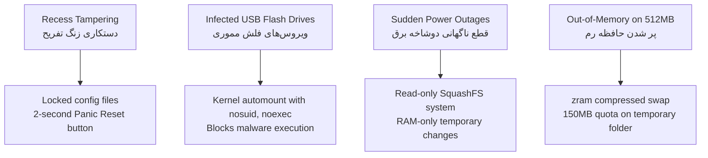

# MaktabOS (سیستم‌عامل مکتب)

**An ultra-lightweight, immutable, and tamper-proof Linux operating system designed to revive decommissioned and low-spec PCs in Iranian schools.**

[](LICENSE)
[]()
[-D70A53.svg)](https://www.debian.org/)
[]()
[]()

---

## Table of Contents

1. [Founder's Story: Why I Started MaktabOS](#1-founders-story-why-i-started-maktabos)
2. [The Core Problem in Iranian Schools](#2-the-core-problem-in-iranian-schools)
3. [Field Realities and Constraints](#3-field-realities-and-constraints)
4. [32-Bit (i386) Support: Why We Keep It](#4-32-bit-i386-support-why-we-keep-it)
5. [Why Existing Solutions Do Not Work](#5-why-existing-solutions-do-not-work)
6. [System Architecture and Specifications](#6-system-architecture-and-specifications)
7. [Threat Model & Security Design](#7-threat-model--security-design)
8. [Hardware Compatibility Matrix (HCL)](#8-hardware-compatibility-matrix-hcl)
9. [National Textbook Compatibility](#9-national-textbook-compatibility)
10. [Key Custom Subsystems](#10-key-custom-subsystems)
    - [10.1. Immutable Storage & RAM Limits](#101-immutable-storage--ram-limits)
    - [10.2. Windows Compatibility Layer (`school-exe-runner`)](#102-windows-compatibility-layer-school-exe-runner)
    - [10.3. Fast Modular Offline Store](#103-fast-modular-offline-store)
    - [10.4. Security, USB Lock, and Panic Button](#104-security-usb-lock-and-panic-button)
    - [10.5. Old Projector & Display Automation](#105-old-projector--display-automation)
    - [10.6. Zero-Config Local Network (ZeroConf)](#106-zero-config-local-network-zeroconf)
11. [Installation & Deployment Methods](#11-installation--deployment-methods)
12. [Project Structure](#12-project-structure)
13. [Project Roadmap](#13-project-roadmap)
14. [بخش فارسی (Persian Section & Founder's Story)](#بخش-فارسی-persian-section--founders-story)
15. [License](#license)

---

## 1. Founder's Story: Why I Started MaktabOS

I am a student at **SAMPAD** (the *National Organization for Development of Exceptional Talents* — Iran’s public gifted school network). I currently study at **Shahid Bahonar 3** (the top gifted school in my city) and will continue at **Soltani 3** in upcoming years.

Our school is considered one of the best-equipped schools in the entire country. Yet, this is our actual day-to-day hardware reality:
* Our school has **12 classrooms**. Each classroom has a single decommissioned PC with at most **4 GB of RAM**, an old weak CPU, worn-out VGA and HDMI cables, unreliable boot issues, and very old classroom projectors.
* We have **one computer lab with 14 computers** running Windows 10, connected together through a basic unmanaged switch.

Experiencing this every single day made me realize a much bigger problem:  
**If this is the situation in one of the top gifted schools in the country, what is happening in thousands of regular public schools?**

In most schools across Iran, computer equipment is much worse. They have ancient 32-bit mini PCs (like early Asus Tinker Boards) or scrap desktop towers with weak dual-cores and just **2 GB (or even 512 MB to 1 GB) of RAM**. These machines run bloated versions of Windows that can barely boot, let alone run applications smoothly.

On top of the weak hardware, computer labs face constant recess chaos:
1. **Recess Misbehavior:** Students change desktop wallpapers to internet memes, change system passwords and forget them, or use unpatched Windows bugs to demote Administrator accounts to standard users, locking everyone out.
2. **Sudden Power Cuts:** When class ends, students, teachers, or cleaners often turn off machines by pulling the power plug directly, switching off the power strip, or cutting the main room fuse. This corrupts the Windows filesystem (NTFS) and ruins hard drives.
3. **Teacher Frustration:** Teachers avoid using computers because troubleshooting these problems wastes precious class time, and schools cannot afford full-time IT technicians.

I personally lived through every single one of these issues. 

That is why I decided to create **MaktabOS**. 

MaktabOS is not another heavy Linux distribution that requires 2 GB of RAM just to show the desktop. It is also not a complex system that needs a network engineer to set up. It is an **ultra-lightweight, self-healing, unbreakable operating system** tailored specifically to the real-life conditions of Iranian schools.

---

## 2. The Core Problem in Iranian Schools

Thousands of functional computer motherboards sit unused in Iranian schools simply because modern operating systems are too heavy and older Windows versions are too fragile.

* **Windows XP & 7** are unmaintained, collect malware from student USB drives within seconds, and break when power is cut abruptly.
* **Modern Windows (10 & 11)** requires modern CPUs, SSDs, and at least 4 to 8 GB of RAM to be usable.
* **School Budgets** cannot replace millions of computers across the country.

MaktabOS revives these machines by running smoothly on systems with **512 MB to 2 GB of RAM**, booting in seconds from legacy hard drives, and making the system immune to software corruption and dirty shutdowns.

---

## 3. Field Realities and Constraints

To succeed in a real Iranian school, an operating system must meet five strict rules:

1. **Exact Match with National Textbooks:**  
   The national school textbooks (*Work and Technology* for grades 7 to 9, and vocational IT books) teach computing based on the Windows desktop layout (e.g., *This PC*, *Drive C:*, *Drive D:*, standard wizard installers, and Python's standard `idle3` editor). Teachers will reject any system that does not match the textbook pictures.
2. **100% Power-Cut Proof:**  
   The system must tolerate being unplugged while running, without corrupting the disk or requiring a filesystem check (fsck).
3. **Two-Second Reset (Zero-Maintenance):**  
   If students mess up settings or delete icons during a 10-minute recess, the class monitor must be able to restore the computer to a clean state in two seconds.
4. **Works on Isolated Switches (Zero-Conf LAN):**  
   Computer labs connect 15 to 20 computers using a simple, unmanaged switch. There is usually no internet, no router, and no DHCP server. The computers must find each other automatically.
5. **Handles Damaged Video Cables:**  
   Projectors frequently use old, stretched VGA cables with broken DDC pins. The operating system must force a safe video signal even when the projector fails to report its resolution.

---

## 4. 32-Bit (i386) Support: Why We Keep It

Almost all major Linux distributions (Ubuntu, Fedora, Arch, ChromeOS Flex) have dropped 32-bit x86 support. 

However, in Iranian schools, **a huge portion of scrap computers are 32-bit only** (Intel Pentium 4 NetBurst, Celeron D, Athlon XP, and early Intel Atom chips).

MaktabOS treats **32-bit (`i386`) as a first-class target**:
* Built on **Debian 12 (Bookworm)**, which officially maintains rock-solid 32-bit kernels (`linux-image-686-pae` and `586`).
* 32-bit binaries use 4-byte memory pointers instead of 8-byte pointers, saving up to **30% of RAM** on low-memory systems.
* Runs educational Windows CDs and 32-bit software natively inside a lightweight WINE environment without needing heavy multi-architecture libraries.
* A 64-bit version (`amd64`) is also built for dual-core and newer 64-bit machines.

---

## 5. Why Existing Solutions Do Not Work

| System | Target Audience | Why It Fails in Iranian Schools |
| :--- | :--- | :--- |
| **Sugar OS** | Elementary OLPC laptops | Non-standard toy interface; does not match national textbooks; teaches no real computer skills. |
| **Endless OS** | Offline home computers | Uses heavy GNOME desktop; Flatpak apps take gigabytes of space and heavy RAM; too slow on old CPUs. |
| **Debian Edu / LTSP** | Centralized school networks | Requires dedicated server hardware and network technicians that schools do not have. |
| **ChromeOS Flex** | Refurbished laptops | Completely drops 32-bit computers; strictly requires high-speed internet and Google accounts. |
| **Yuz-OS Edu** | General Iranian school project | Uses heavy GNOME Core and ClamAV daemon (>1.5 GB idle RAM); 64-bit only; standard mutable disk setup breaks on power cuts. |
| **Legacy Windows (XP / 7)** | Commercial legacy desktop | Instantly infected by USB shortcut viruses; NTFS filesystems break when power is pulled; unlicensed. |
| **MaktabOS** | **Legacy PCs (512MB–2GB RAM)** | **Zero internet required, 100% immutable, sub-100MB RAM, 32-bit + 64-bit, and identical to textbook layout.** |

---

## 6. System Architecture and Specifications

```text
+-----------------------------------------------------------------------------------+
|                                 USER DESKTOP                                      |
|  - Openbox Window Manager (Uses less than 15 MB RAM)                              |
|  - Tint2 Taskbar (Windows layout, Persian Shamsi calendar, FA/EN language switch)|
|  - Rofi Start Menu (Windows 10/11 theme, instant search)                          |
|  - Picom Compositor (Software XRender backend, smooth rounded corners)            |
|  - PCManFM File Manager (Shows This PC, Drive C, Drive D, Recycle Bin)            |
+-----------------------------------------------------------------------------------+
|                              EXECUTION DISPATCHER                                 |
|  - school-exe-runner: Runs native Linux apps or 32-bit WINE with Tahoma fonts     |
|  - fake-installer: Simulated wizard installer for student textbook practice       |
|  - offline-store: Instant loop-mounted SquashFS application bundles               |
+-----------------------------------------------------------------------------------+
|                            IMMUTABLE STORAGE STACK                                |
|  - OverlayFS Union Mount                                                          |
|    ├── Upper Layer (Read-Write): tmpfs (RAM-backed, 150MB limit)                  |
|    └── Lower Layer (Read-Only): SquashFS image (compressed on disk)               |
|  - zram: RAM compression swap (makes 512MB act like 1GB+)                         |
|  - Drive D: Persistent Ext4 disk partition for student homework                   |
+-----------------------------------------------------------------------------------+
|                         BASE SYSTEM & LINUX KERNEL                                |
|  - Debian 12 (Bookworm) minimal base                                              |
|  - Linux LTS Kernel (i386 and amd64 architectures)                                |
+-----------------------------------------------------------------------------------+
```

### Technical Specification Matrix

| Parameter | Specification | Why This Was Chosen |
| :--- | :--- | :--- |
| **Base System** | Debian 12 (*Bookworm*) minimal | Best stability, huge package ecosystem, active 32-bit support. |
| **Architectures** | `i386` (32-bit) and `amd64` (64-bit) | Supports all legacy Pentium/Celeron PCs as well as newer 64-bit computers. |
| **Idle RAM Usage** | **65 MB – 95 MB** | Leaves more than 75% of a 512 MB machine free for user applications. |
| **Filesystem Type** | `SquashFS` + `OverlayFS` + `tmpfs` | 100% safe from sudden power cuts; system disk never changes. |
| **RAM Compression** | `zram` with `lz4` compression | Doubles usable RAM without wearing out slow, old hard drives. |
| **Window Manager** | `Openbox` | Extremely fast, reliable on ancient SiS, VIA, and Intel GMA graphics chips. |
| **Panel / Taskbar** | `Tint2` | Native Persian calendar (Shamsi), language flag indicator, Windows look. |
| **Start Menu** | `Rofi` (Custom Windows theme) | Instant search, clean organization, zero desktop lag. |
| **Font & Text** | **Vazirmatn** (FreeType hintfull) | Clear, sharp Persian text even on low-resolution CRT and LCD screens. |

---

## 7. Threat Model & Security Design

MaktabOS is protected against the real physical and local threats found in schools:



1. **Recess Misconfiguration:**
   * Students cannot delete desktop icons or change core settings because files are locked (`chattr +i`).
   * If a student rotates the screen or changes wallpaper, the class monitor presses `Ctrl + Alt + Backspace` or clicks the taskbar Panic button. The desktop reloads to a clean state in under **2 seconds**.
2. **Infected USB Drives:**
   * USB drives are mounted automatically with the `noexec,nosuid,nodev` options. 
   * Windows shortcut worms and executable viruses cannot run. Students can safely view PDFs, images, and run Python source files through the system's Python interpreter (`python3 script.py`).
3. **Pulling the Power Cable:**
   * The operating system files are stored in a read-only compressed `SquashFS` file. No writes happen on the system partition.
   * Pulling the power cord simply clears the temporary RAM layer. The hard drive suffers zero filesystem corruption.
4. **Running Out of RAM:**
   * `zram` compresses memory pages on the fly, doubling effective RAM.
   * The temporary `/home/student` folder in RAM has a strict 150 MB size limit so big files must be saved to the persistent `Drive_D` hard disk partition.

---

## 8. Hardware Compatibility Matrix (HCL)

MaktabOS is tested to work out of the box with common legacy parts found in Iranian schools:

| Hardware Part | Models | Driver Used | Fallback Strategy |
| :--- | :--- | :--- | :--- |
| **Processors** | Intel Pentium 4, Celeron D, Core 2 Duo, AMD Athlon XP/64 | Linux LTS `i386` and `amd64` | Universal 32-bit safe kernel mode |
| **Old Intel Graphics** | Intel GMA 900, 950, 3000, 3100, X3100 | `modesetting` / `intel` driver | Picom XRender software renderer |
| **Problematic GPUs** | SiS Mirage 1/2/3 (671/771), VIA UniChrome Pro / Chrome9 | `sisimedia` / `openchrome` | VESA / FBDev universal video driver |
| **Add-on Video Cards**| NVIDIA FX 5200, 6200, 7300; ATI Radeon 7000, 9200, X300 | Open-source `nouveau` and `radeon` | Standard 2D X11 graphics |
| **Sound Cards** | AC'97, Intel HDA, Sound Blaster PCI | Direct ALSA drivers | PulseAudio/PipeWire bypassed to save 35 MB RAM |
| **Old School Printers**| HP LaserJet 1018, 1020, 1000, P1102; Canon LBP2900 | CUPS + `printer-driver-foo2zjs` | Pre-bundled offline printer firmware |
| **Network Cards** | Realtek 8139, 8111, Intel 10/100, Fast Ethernet | Built-in kernel network drivers | ZeroConf link-local networking |

---

## 9. National Textbook Compatibility

Every part of the MaktabOS interface directly matches the Iranian national school curriculum:

| Grade Level | Textbook Lesson | What the Textbook Teaches | How MaktabOS Solves It |
| :--- | :--- | :--- | :--- |
| **Grade 7 (هفتم)**<br/>Work & Technology | **پودمان کار با رایانه**<br/>(Working with computers) | - Understanding *This PC*, Drive *C:*, Drive *D:*<br/>- Managing folders, Copy/Paste<br/>- Emptying the Recycle Bin | Desktop displays localized icons: *This PC*, *Drive C*, *Drive D (تکالیف)*, and *Recycle Bin*. Linux folders like `/usr` and `/etc` are hidden from students. |
| **Grade 7 (هفتم)**<br/>Work & Technology | **نصب نرم‌افزار**<br/>(Software Installation) | - Opening setup files<br/>- Clicking *Next > I Agree > Install > Finish* | **Fake Wizard Installer:** A practice tool that looks exactly like standard Windows setup wizards so students can practice without modifying system files. |
| **Grade 8 (هشتم)**<br/>Work & Technology | **شهروند الکترونیکی**<br/>(Typing and documents) | - Typing Persian documents<br/>- Paragraph formatting, tables, and margins | Fast lightweight office software with **Vazirmatn** font and standard Right-to-Left (RTL) support. |
| **Grade 9 (نهم)**<br/>Work & Technology | **الگوریتم و پایتون**<br/>(Python programming) | - Writing code in Python IDLE<br/>- Pressing `F5` to run code | Standard Python 3 with **`idle3`** pre-installed. The window matches textbook screenshots pixel-for-pixel. |
| **Vocational (هنرستان)**<br/>Computer Science | **کارگاه شبکه و سخت‌افزار**<br/>(Networking) | - Connecting computers in a lab<br/>- Sharing assignment files | Automatic ZeroConf local networking allows sending files to all student computers instantly. |

---

## 10. Key Custom Subsystems

### 10.1. Immutable Storage & RAM Limits
* The base system is packed into a compressed read-only `SquashFS` image.
* When the computer boots, `OverlayFS` directs any temporary file changes into RAM (`tmpfs`).
* A 150 MB size limit prevents temporary files from filling up RAM.
* Real homework files are saved directly onto a persistent disk partition called `Drive_D`.

### 10.2. Windows Compatibility Layer (`school-exe-runner`)
* If a student double-clicks a Windows `.exe` setup file for something already built into the system (like Python or Scratch), MaktabOS shows a Persian notice: *"This program is already installed on your system"* and launches the native Linux version.
* If the file is an educational textbook CD or autorun disk, it runs automatically inside an optimized 32-bit WINE prefix with Persian Tahoma fonts.

### 10.3. Fast Modular Offline Store
* Heavy educational apps (GeoGebra, GCompris, Scratch, Tux Paint) are stored as separate `.sqfs` packages in `/opt/offline-store/`.
* When a student clicks "Enable" in the app store, MaktabOS loop-mounts the package in **0.1 seconds** (`mount -o loop app.sqfs /opt/apps/app`).
* The application shortcut appears instantly on the desktop without wasting hard disk space on file extraction.

### 10.4. Security, USB Lock, and Panic Button
* Student USB drives are mounted with `noexec` to prevent malware scripts from running.
* If someone messes up the screen or deletes icons, pressing `Ctrl + Alt + Backspace` resets the desktop in 2 seconds.
* When the teacher plugs in a special USB drive containing a cryptographic key (`.masterkey`), administrative controls are unlocked.

### 10.5. Old Projector & Display Automation
* Worn-out VGA cables with broken EDID pins often produce black screens on classroom projectors.
* MaktabOS includes a display helper that automatically forces safe resolutions (`1024x768@60Hz` or `1280x720@60Hz`).
* Pressing `Super + P` switches display modes easily.
* Pressing `F9` launches an on-screen drawing tool (`Gromit-MPX`), allowing the teacher to draw directly over any window.

### 10.6. Zero-Config Local Network (ZeroConf)
* School computer labs usually have only an unmanaged switch without internet or a DHCP router.
* MaktabOS uses `Avahi` to automatically assign link-local IP addresses (`169.254.x.x`).
* Computers identify each other automatically (`maktab-01.local`, `maktab-02.local`).
* The teacher's computer can broadcast assignments directly into every student's `Drive_D` folder.

---

## 11. Installation & Deployment Methods

Deploying MaktabOS across an entire 15-to-20 PC lab takes minutes instead of days:

```text
Method 1 (Single PC via USB):
USB Drive ──(Direct 2-Minute Block Copy)──> Target Hard Drive ──> Ready to Use

Method 2 (Whole Lab via Network PXE):
Teacher PC (PXE Server) ──(Unmanaged Switch: UDP Multicast)──> 20 Workstations in 15 Minutes
```

1. **Method 1: Direct USB Installation (< 2 Minutes per PC):**
   * Pre-built partition images are written directly to the hard drive in under 120 seconds.
   * Creates two partitions: 4 GB for the read-only operating system and the rest for `Drive_D` (student homework).
2. **Method 2: Mass Lab Network Installation (15 Minutes for 20 PCs):**
   * The teacher's computer temporarily acts as a PXE boot server over the lab's switch.
   * All lab computers boot from the network (`F12`).
   * A single multicast stream installs the complete system image on all 20 computers at the same time.

---

## 12. Project Structure

```text
MaktabOS/
├── build/                   # OS image bootstrap and ISO compiler
│   ├── configs/             # Package lists for i386 and amd64
│   ├── scripts/             # Chroot configuration scripts
│   └── build-iso.sh         # Main build script
├── overlay/                 # Files overlaid directly on rootfs
│   ├── etc/                 # System configuration (Openbox, Tint2, Rofi, udev)
│   ├── usr/                 # Core scripts and custom binaries
│   └── skel/                # Student user profile template
├── modules/                 # Standalone custom tools
│   ├── school-exe-runner/   # Intelligent .exe runner & WINE layer
│   ├── fake-installer/      # Curriculum installer practice tool
│   ├── offline-store/       # Modular SquashFS app store GUI
│   ├── kiosk-security/      # Panic scripts, udev rules, and USB sandbox
│   └── projector-auto/      # VGA safe resolution daemon
├── packages/                # Build recipes for modular .sqfs applications
├── docs/                    # Architecture and developer documentation
├── LICENSE                  # GNU General Public License v3.0
└── README.md                # Project documentation and specifications
```

---

## 13. Project Roadmap

- [ ] **Milestone 1: Project Foundation & Architecture**
  - [x] Complete technical specifications and open-source licensing under GPLv3.
  - [ ] Standardize project directory structure.
- [ ] **Milestone 2: RootFS Generation & Live-Boot Layer (MVP)**
  - [ ] Write automated `debootstrap` scripts for Debian 12 minimal (`i386` and `amd64`).
  - [ ] Configure `initramfs` hooks for SquashFS root, OverlayFS, and `zram`.
  - [ ] Set up automatic detection for the persistent `Drive_D` partition.
- [ ] **Milestone 3: Desktop Environment & Textbook Look**
  - [ ] Configure Openbox, Tint2, and Rofi to match the Windows layout.
  - [ ] Add Persian **Vazirmatn** typography with clear subpixel rendering for CRT/LCD screens.
  - [ ] Add Shamsi (Jalali) calendar to the desktop taskbar.
- [ ] **Milestone 4: Core School Tools**
  - [ ] Build and test the `school-exe-runner` script and WINE 32-bit sandbox.
  - [ ] Create the modular GTK/Python offline store for `.sqfs` packages.
  - [ ] Test udev security rules for USB `noexec`, panic reset, and teacher master keys.
- [ ] **Milestone 5: Hardware Automation, Printers & ISO Release**
  - [ ] Pre-package offline drivers and firmware for common school printers (`foo2zjs`, `hplip`).
  - [ ] Add Avahi link-local networking and teacher broadcast tools.
  - [ ] Release the first bootable ISO image.

---

## بخش فارسی (Persian Section & Founder's Story)

### ۱. داستان پیدایش مکتب‌او‌اس: چرا این پروژه را شروع کردم؟

من دانش‌آموز مدارس **سمپاد** (سازمان ملی پرورش استعدادهای درخشان) هستم. در حال حاضر در دبیرستان **شهید باهنر ۳** (بهترین سمپاد شهرمان) درس می‌خوانم و در سال‌های آینده به **سلطانی ۳** خواهم رفت.

مدرسه ما یکی از مدارسی در کشور است که جزو بهترین‌ها به حساب می‌آید و بیشترین امکانات را دارد، اما واقعیت میدانی سخت‌افزارهای ما سر کلاس این است:
* مدرسه ما **۱۲ کلاس** دارد. در هر کلاس یک کامپیوتر اسقاطی با نهایتاً **۴ گیگابایت رم** و پردازنده‌های قدیمی و ضعیف قرار دارد. کابل‌های VGA و HDMI مکرراً مشکل دارند، بالا آمدن سیستم‌عامل با دردسر و اتلاف وقت همراه است و پروژکتورهای متفاوتی داریم که بسیار قدیمی هستند.
* یک **سایت کامپیوتر با ۱۴ سیستم** داریم که هر کدام SSD با ظرفیت ۳۰۰ گیگابایت دارند و ویندوز ۱۰ رویشان نصب است و فقط با یک سوییچ ساده به هم متصل شده‌اند.

دیدن هر روزه این صحنه‌ها من را به یک سوال اساسی رساند:  
**اگر در یکی از بهترین مدارس سمپاد کشور وضعیت سخت‌افزار این است، پس بقیه مدارس عادی چه می‌کشند؟**

بیشتر مدارس دیگر یا کامپیوترهای اسقاطی با **رم ۲ گیگابایت (یا حتی ۵۱۲ مگابایت تا ۱ گیگابایت)** و قطعات بسیار ضعیف دارند، یا از مینی‌پی‌سی‌های بسیار قدیمی و ۳۲ بیتی (مثل تینکر بورد ایسوس) استفاده می‌کنند که ویندوز به زور رویشان بوت می‌شود و اصلاً قابل استفاده روان نیست.

علاوه بر ضعف شدید سخت‌افزار، ماجراهای زنگ تفریح و نگهداری سیستم‌ها هم یک دردسر تمام‌نشدنی است:
۱. **خرابکاری‌های زنگ تفریح:** بچه‌ها بک‌گراند کامپیوترها را به میم (Meme) تغییر می‌دهند، رمز ویندوز را عوض می‌کنند و یادشان می‌رود، یا از باگ‌های نسخه‌های قدیمی و پچ‌نشده ویندوز استفاده می‌کنند و تمام دسترسی‌های Administrator را به یوزر معمولی (Standard) تغییر می‌دهند و سیستم را قفل می‌کنند.
۲. **خاموش کردن غیراصولی:** موقع رفتن از کلاس، کابل برق سیستم را مستقیم از پریز می‌کشند، کلید چندراهی برق را می‌زنند یا فیوز را قطع می‌کنند. این کار باعث خراب شدن سکتورهای هارد دیسک و نابودی ویندوز می‌شود.
۳. **ترس معلمان از استفاده:** معلم‌ها به خاطر همین دردسرها و نداشتن دانش فنی برای حل مشکلات مداوم، ترجیح می‌دهند اصلاً کامپیوتر کلاس را روشن نکنند.

من تک‌تک این مشکلات را به چشم دیدم و تجربه کردم.

به همین دلیل به این نتیجه رسیدم که باید یک **سیستم‌عامل اختصاصی برای شرایط واقعی مدارس کشورمان** بسازم. مکتب‌او‌اس قرار نیست مثل پروژه‌های موجود، رم زیاد مصرف کند یا برای راه‌اندازی و نگهداری نیاز به متخصص شبکه و دانش بالا داشته باشد؛ بلکه سیستم‌عاملی است که روی رم ۵۱۲ مگابایت مثل برق کار می‌کند، با کشیدن برق خراب نمی‌شود و زنگ تفریح به هم نمی‌ریزد.

---

### ۲. چرا پشتیبانی ۳۲ بیتی (i386) را حذف نکردیم؟
اکثر توزیع‌های لینوکس امروزی پشتیبانی از ۳۲ بیت را کنار گذاشته‌اند. اما در مدارس ایران، بخش زیادی از کامپیوترهای اسقاطی پردازنده‌های صرفاً ۳۲ بیتی دارند (پنتیوم ۴ و سلرون D). مکتب‌او‌اس بر پایه دبیان ۱۲ به طور رسمی از معماری **۳۲ بیتی (`i386`) در کنار ۶۴ بیتی (`amd64`)** پشتیبانی می‌کند تا هیچ سیستمی در مدرسه دور انداخته نشود. علاوه بر این، نسخه‌های ۳۲ بیتی تا ۳۰ درصد رم کمتری مصرف می‌کنند.

### ۳. ویژگی‌های اصلی سیستم‌عامل مکتب
1. **فایل‌سیستم ضد قطع برق (SquashFS + tmpfs):** سیستم‌عامل در یک ایمیج فشرده فقط‌خواندنی قرار دارد و تمامی تغییرات موقت در رم اتفاق می‌افتد. کشیدن کابل برق هیچ آسیبی به فایل‌های سیستم نمی‌زند.
2. **مصرف رم زیر ۱۰۰ مگابایت:** با مدیریت پنجره Openbox و تسکبار Tint2، سیستم در حالت بیکار کمتر از ۱۰۰ مگابایت رم می‌گیرد و روی سیستم‌های ۵۱۲ مگابایتی کاملاً روان است.
3. **انطباق ۱۰۰٪ با کتاب درسی:** ظاهر شبیه ویندوز (شامل This PC، درایو C، درایو D تکالیف، سطل آشغال)، مفسر پایتون IDLE 3 دقیقاً مشابه کتاب، و شبیه‌ساز ویزارد نصب (Fake Wizard) برای تمرین مراحل نصب بدون خراب کردن ویندوز.
4. **اجراکننده هوشمند (`school-exe-runner`):** اجرای نسخه لینوکسی برنامه‌ها در صورت کلیک روی نصاب ویندوزی پایتون/اسکرچ، و اجرای خودکار اتوران‌ها و لوح‌های فشرده مدارس در WINE 32-bit بهینه با فونت فارسی Tahoma.
5. **امنیت فلش و دکمه نجات ۲ ثانیه‌ای:** ماونت خودکار فلش با فلگ `noexec` برای جلوگیری از اجرای ویروس‌ها، و بازنشانی سریع کل محیط دسکتاپ ظرف ۲ ثانیه با `Ctrl+Alt+Backspace`.
6. **حل مشکل کابل فرسوده پروژکتور:** اعمال خودکار رزولوشن‌های امن (`1024x768`) بدون نیاز به اطلاعات EDID کابل‌های قطعی‌دار VGA، به همراه ابزار خط‌کشی روی صفحه برای معلم (`F9`).
7. **شبکه کارگاهی بدون روتر (ZeroConf):** اتصال خودکار سیستم‌ها با یک سوییچ ساده از طریق آدرس‌های Link-Local بدون نیاز به مودم یا سرور DHCP.

---

## License

MaktabOS is free software licensed under the **GNU General Public License Version 3.0 (GPLv3)**. See the [LICENSE](LICENSE) file for complete licensing terms and conditions.
